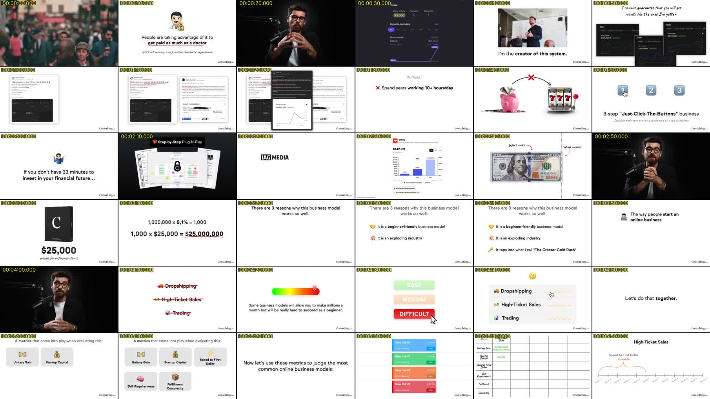
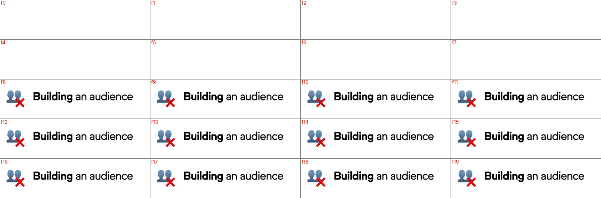
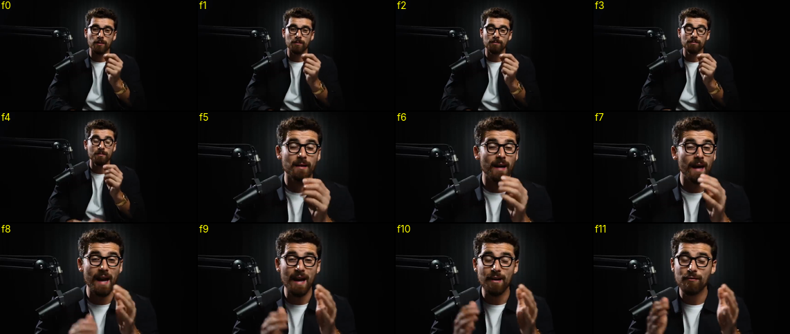
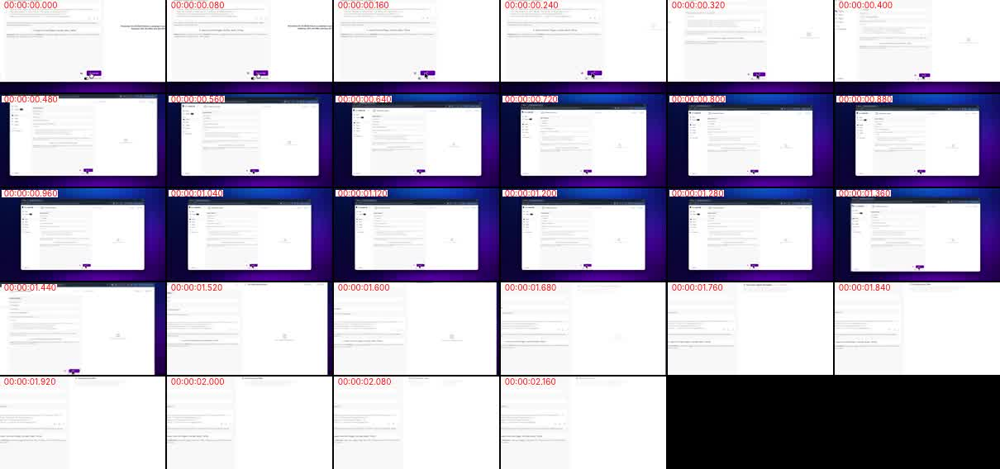

# Análisis de referencia: VSL "Consulting.com — Creator Gold Rush"

Video: `month In 2026 (Beginner Friendly).mp4` · 44:55 · 854×480 · 25 fps · H.264 + AAC estéreo 44,1 kHz.
Se analizaron los **67.377 fotogramas** (OpenCV: diferencia entre fotogramas, histograma de color,
flujo óptico para zoom/paneo), **10.743 palabras** transcritas con marcas de tiempo, OCR de 371 slides,
y yo revisé a ojo más de 500 fotogramas (hojas cada 10 s, el hook a 5 fps y animaciones a 25 fps).

Herramienta reutilizable: `python herramientas/analizar_referencia.py VIDEO SALIDA`.

---

## 1. Resumen en una frase

Es un **VSL de "slides con voz en off"**: el 82 % del tiempo es una pantalla blanca con texto
negro corto + emoji/imagen, que cambia **cada 1,6 s** sincronizada con la voz, narrada a
**~239 palabras por minuto sin pausas**. El presentador solo sale a cámara el 11 % del tiempo,
en planos de ~4 s para "humanizar". Nada de subtítulos, nada de efectos de sonido, nada de zooms
sobre las slides: el ritmo lo da **la cantidad de cambios visuales**, no los adornos.

## 2. Estructura del video (lo que se ve, minuto a minuto)

| Tramo | Contenido | Formato visual |
|---|---|---|
| 0:00–0:08 | Hook: presentador + 3 B-rolls de stock (TPV con tarjeta, manos en portátil, multitud) | Cámara oscura, cortes cada ~0,8 s en los B-rolls |
| 0:08–3:00 | Promesa ("get paid as much as a doctor"), prueba (capturas de ventas, Stripe/Whop), autoridad ("I'm the creator of this system"), logos de medios | Slides blancas + capturas |
| 3:00 | Revelación del logo Consulting.com letra a letra (~0,7 s) | Fondo negro |
| 3:10–10:00 | "3 razones", comparación de 4 modelos de negocio con una **tabla que se va rellenando** celda a celda (Dropshipping, Afiliados, Trading, "Ideal Model") | Slides blancas, tabla manuscrita en rojo/verde |
| 10:00–19:50 | El mecanismo: micro-creadores, partnership 70/30, el problema y la solución | Slides + capturas de chats/perfiles |
| 20:00–33:40 | **Demo del software** (Synthesise AI / Ghostwriter OS) | Grabación de pantalla completa + **cámara en burbuja circular abajo a la izquierda** |
| 33:40–36:00 | Resultados de clientes, ofertas recurrentes | Slides |
| 36:00–42:50 | Oferta: UpLevel, Quantum, consultores, llamadas semanales | Tarjetas de producto sobre degradados oscuros azul/morado |
| 42:50–44:50 | CTA: "Done-With-You", plazas limitadas, qué pasa en la llamada, cierre "Creator Gold Rush" | Slides blancas |
| 44:50 | Fundido a negro | — |



## 3. Ritmo y cortes (datos medidos)

| Métrica | Valor |
|---|---|
| Cambios visuales totales (cualquier elemento que aparece o cambia) | **1.714** → uno cada **1,57 s** |
| Intervalo entre cambios | mediana **0,84 s** · p75 2,3 s · p90 3,9 s · máximo 19,8 s |
| Slides/escenas nuevas (cambio grande de imagen) | **501** → una cada **5,4 s** (mediana 3,8 s) |
| Slides nuevas por minuto | 5–22, típico 10–14 |
| Cambios por minuto en zona de slides | 15–30 · en la demo de software 95–155 |
| % de frases habladas con un cambio visual en ±0,5 s | **75 %** |
| Sincronía cambio visual ↔ inicio de palabra | mediana **−0,02 s** (77 % dentro de ±0,12 s) |

**Lectura de editor:** cada frase nueva trae algo nuevo en pantalla, y aparece *en el mismo
fotograma* en que empieza la palabra (o 1 fotograma antes). Esa sincronía al milisegundo es lo
que hace que se sienta "profesional" aunque los gráficos sean sencillos.

## 4. Animaciones (fotograma a fotograma)

- **Aparición de elementos = corte seco de 1 fotograma.** El 55 % de los cambios ocurre en un
  único fotograma; el texto pasa de no existir a estar completo (f7 → f8). Sin fundido, sin
  deslizamiento, sin rebote. 
- **Construcción acumulativa ("build"):** las listas se arman ítem a ítem, cada uno cuando la
  voz lo nombra ("All without ever: ✗ Showing their face → ✗ Creating content → ✗ Building an
  audience", ~1–1,5 s entre ítems). La tabla comparativa se rellena celda a celda durante ~5 min
  y se vuelve a mostrar completa como recapitulación.
- **Subrayados rojos a mano alzada** debajo de la frase clave o la cifra
  ("get paid as much as a doctor", "$25,000,000"): aparecen **a la vez que el texto**, no se
  dibujan animados.
- **Tachado rojo** para descartar opciones (Dropshipping, High-Ticket, Trading).
- **Slides 100 % estáticas:** el flujo óptico no detecta zoom lento (Ken Burns) en ninguna slide.
  Solo el 5,5 % de los fotogramas tiene cambio de escala, y casi todo es movimiento natural del
  presentador o B-roll en mano.
- **Punch-in en el presentador:** cortes de plano abierto → cerrado (~1,35×) coincidiendo con un
  jump cut (por ejemplo a 0:02.2). 
- **Zoom-out "showcase" de la pantalla** (30:00): la grabación se aleja en ~0,4 s y queda
  enmarcada sobre un degradado morado ~1 s, luego vuelve a pantalla completa en ~0,4 s.
  
- **Revelación de logo letra a letra** (3:00) sobre negro, ~0,7 s.
- **Puntero/clic animado** (mano de cursor sobre botones "Generate", estrellas, "Difficult") para
  simular interacción.
- **Contadores visuales:** cuadrículas de sacos de dinero / puntos que se "encienden" para
  representar cantidades (1 de cada 100, 10 sacos → solo 1-4 se quedan).

## 5. Tipografía y diseño de slides


| Elemento | Estilo observado | Equivalente gratuito sugerido |
|---|---|---|
| Texto principal | Sans geométrica-humanista, negro sobre blanco, centrado, ~4–5 % de la altura; peso regular + **negrita solo en las palabras clave** | Gilroy (comercial) → *Outfit*, *Figtree* o *Plus Jakarta Sans* |
| Frase de remate | Manuscrita en cursiva gris oscuro ("Without having any previous business experience.") | *Caveat* / *Kalam* |
| Anotaciones en tablas y flechas | Manuscrita en rojo (negativo) / verde (positivo) | *Caveat* |
| Marca de agua | "Consulting.com" serif, abajo a la derecha, fija todo el video | — |
| Iconografía | **Emojis estilo Apple** (😉💰👨‍⚕️✅❌) grandes, encima del texto o a la izquierda de cada ítem; ❌ rojo superpuesto para negar | Emojis Apple/Noto |
| Fondos | Blanco puro (82 %); degradados oscuros azul→morado para productos/oferta | — |
| Densidad de texto | Mediana **15 palabras** por slide (p25 = 7); 1–3 líneas | — |
| Relación con la voz | Solo ~28 % de las palabras en pantalla coinciden literalmente con lo que se dice: la slide **resume/parafrasea**, no transcribe | — |

**No hay subtítulos** en ningún momento, ni siquiera cuando habla a cámara.

## 6. Voz, pausas y audio

| Métrica | Valor |
|---|---|
| Velocidad | **239 palabras/min** (estable: 210–282 por minuto) — muy por encima de una charla normal (150–170). Probablemente voz acelerada en edición y/o cortada muy apretada |
| Huecos entre palabras | p95 = **0,16 s**; solo 12 pausas > 0,5 s y 1 > 1,2 s en 45 min |
| Tiempo total en pausas > 0,25 s | 75 s (2,8 %) |
| Frases | 662 · mediana 11 palabras · 2,6 s |
| Loudness integrado | **−19,2 LUFS** · rango 6,2 LU (voz muy comprimida y constante) |
| Música | **Cama musical ambiental continua** los 45 min (pad tonal, nota sostenida ~310 Hz), a ~−40 dBFS en pausas: ~18–20 dB por debajo de la voz |
| Efectos de sonido | **Ninguno detectable.** Transitorios en cambios visuales: 10 % = exactamente el azar |
| Disfluencias que dejaron | 3 "uh" y 5 tartamudeos en la demo de software (20–31 min); el resto limpio |

## 7. Qué hace bien y dónde se puede mejorar

**Copiar:**
1. Un cambio visual por frase, sincronizado al fotograma con la primera palabra.
2. Builds acumulativos para listas y tablas (el espectador "espera" el siguiente ítem).
3. Negrita solo en 1–3 palabras por slide + subrayado rojo en la cifra/promesa.
4. Cortar respiraciones: huecos de 0–0,16 s, ritmo implacable.
5. Volver a cámara cada ~30 s (55 apariciones, ~4 s cada una) para mantener la conexión humana.
6. Cama musical suave y constante, sin protagonismo.

**Mejorable (oportunidades para nuestra versión):**
1. **Resolución 480p**: las capturas y la demo de software (13 min) son ilegibles en móvil.
   Exportar mínimo 1080p y hacer **zoom a la zona de la pantalla** que se está explicando.
2. La demo de software no tiene zooms ni resaltados: es el tramo más largo y menos dinámico.
3. Sin subtítulos en las partes a cámara: en móvil sin sonido se pierde ese contenido.
4. −19 LUFS queda bajo para redes/web (estándar −14 a −16).

## 8. Cómo replicarlo con nuestro editor

Con lo que ya tenemos (`vsl_editor`), para un video del presentador al estilo de esta referencia:

```bash
python -m vsl_editor editar entrada/VIDEO.mp4 --ritmo rapido --pausa-max 0.16 \
    --sin-sfx --color natural --musica cama.mp3 --musica-db -20
```

- `--ritmo rapido --pausa-max 0.16` reproduce los huecos medidos (p95 = 0,16 s).
- `--sin-sfx` porque la referencia no usa efectos.
- Los punch-in automáticos en los cortes ya replican el que usa en los planos a cámara.
- Subtítulos: la referencia no los usa, pero recomiendo mantenerlos en los tramos a cámara.

**Lo que falta para replicarlo al 100 %** es el motor de *slides*: generar automáticamente, a
partir de la transcripción, slides blancas con texto resumido + emoji + negritas + subrayado
rojo, que aparezcan sincronizadas palabra a palabra. Es el 82 % de este video y es totalmente
automatizable con lo que ya tenemos (transcripción con marcas de tiempo + render con ffmpeg).

## 9. Calibración aplicada al editor tras este análisis

En un video ya editado y pulido, el detector original marcaba 34 fragmentos para cortar. La
mayoría eran **recursos retóricos intencionales**, así que se corrigió para conservarlos:

- Anáfora / paralelismo: "The way we buy, the way we work…", "It's got the hook variations.
  It's got the CTA variations…"
- Contraste: "The hard part *isn't*… The hard part *is*…", "non-expert… or expert…"
- Énfasis: "Insane. Insane. Insane.", "very very", "hours and hours"
- Anadiplosis: "…high ticket sales. High ticket sales is…"
- "win-win" (Whisper separa el guion)

Ahora marca 8, todas disfluencias reales ("that that", "the The", "uh", "you're going to do is
you're going to…"), y sigue detectando el 100 % de los errores del video de prueba en español.
